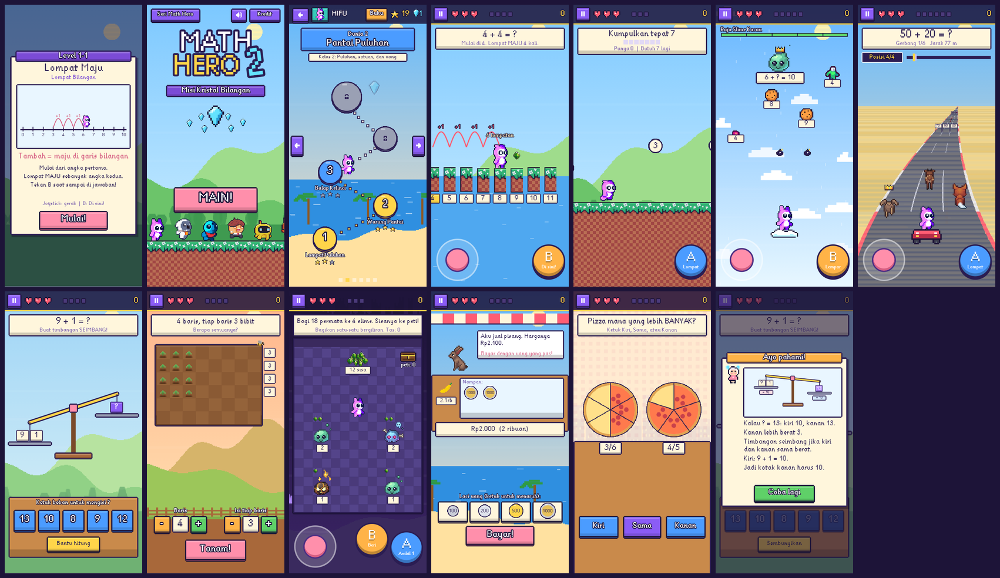

# Seri Math Hero

Seri game belajar matematika berbentuk petualangan pixel art untuk anak kelas 1 sampai 4 SD. Dimainkan di Chrome Android lewat jaringan lokal (hotspot HP), jadi tidak perlu internet saat bermain.

Halaman awal (`/`) sekarang adalah **pemilih seri**:

| Seri | Alamat | Isi |
|---|---|---|
| **Math Hero 1**: Petualangan di Kerajaan Awan | `mh1/` | Platformer, 8 level, 4 bos. Dijelaskan di bagian [Math Hero 1](#math-hero-1). |
| **Math Hero 2**: Misi Kristal Bilangan | `mh2/` | 6 dunia x 5 level, 9 jenis permainan, 6 bos. Dijelaskan di bagian [Math Hero 2](#math-hero-2). |
| **Math Hero 3**: Misi Kristal Bilangan | `mh3/` | Kelas 2-5 SD, 4 dunia x 5 level (Bertahan, Kejar, Bos), PR adaptif. Dijelaskan di bagian [Math Hero 3](#math-hero-3). |

Keduanya dijaga dengan prinsip yang sama: anak **memahami konsep** (bukan menebak), semua jawaban pilihan/sentuh tanpa keyboard HP, kesalahan dijawab dengan penjelasan ramah, dan gaya pixel art.

# Math Hero 1

Game petualangan platformer matematika untuk anak kelas 1 sampai 4 SD (8 level: level 1-2 kelas 1, 3-4 kelas 2, 5-6 kelas 3, 7-8 kelas 4).

## Cara menjalankan

1. Pastikan laptop dan HP terhubung ke hotspot yang sama. Nyalakan hotspot di HP, lalu sambungkan laptop ke hotspot itu.
2. Klik 2x `run.bat` di folder project.
   - Pertama kali, skrip memeriksa Node.js. Jika belum ada, skrip memasangnya lewat winget. Jika pemasangan selesai, tutup jendela, lalu klik 2x `run.bat` lagi.
   - Jendela akan menampilkan alamat seperti `http://10.x.x.x:8091`. Itu alamat untuk HP.
3. Di HP, buka Chrome dan ketik alamat itu. Jangan pakai `localhost` di HP, karena itu mengarah ke HP sendiri. Halaman pertama adalah pemilih seri: ketuk **Main Math Hero 1** atau **Main Math Hero 2**.
4. Untuk menghentikan server, tutup jendela `run.bat` atau tekan Ctrl+C di jendela itu.

Kalau alamat IP laptop berubah (misalnya setelah hotspot dimatikan dan dinyalakan lagi), jalankan `ipconfig` di laptop dan cari IPv4 Address pada adapter Wi-Fi atau hotspot. Pakai angka itu di HP.

### Firewall Windows

Saat pertama kali server berjalan, Windows bisa menampilkan peringatan firewall. Izinkan akses untuk jaringan **Private**. Jika terlanjur menolak, buka PowerShell sebagai administrator lalu jalankan:

```
netsh advfirewall firewall add rule name="Math Hero" dir=in action=allow protocol=TCP localport=8091
```

Jika server dijalankan dengan port lain, ganti `8091` sesuai port yang tampil di jendela.

## Kontrol

- **Joystick** (kiri bawah): jalan ke kiri dan kanan. Geser ke atas atau bawah untuk mengintip layar. Geser ke bawah sambil menekan Lompat untuk turun dari platform tipis.
- **Lompat** (kanan bawah): lompat. Di udara tekan lagi untuk lompat ganda.
- **B** (di samping Lompat): buka peti soal, pecahkan tumpukan peti, pasang jembatan, serang bos yang sedang pusing. Tekan saat gelembung "Tekan B" muncul. Jika tidak ada sasaran, karakter bergaya (salto, joget, atau ta-da) sebagai hiburan.
- **Jeda** (kanan atas): berhenti sejenak. Tekan lagi untuk lanjut.
- **Senyap / Bersuara** (sebelah kiri Jeda): mematikan atau menyalakan suara dan musik.

## Aturan permainan

- Tiap level punya **peti soal** (tanda ?). Semua peti harus dijawab agar trofi di ujung level terbuka. Level dengan bos mengharuskan bos dikalahkan juga.
- **Tumpukan peti** menghalangi jalan: jawab soal untuk memecahkannya. **Jembatan** di atas jurang dipasang bagian demi bagian dengan jawaban benar. **Platform pilih jawaban** (angka di platform) memberi bonus jika kamu menginjak yang benar.
- **Bos** (level 2, 4, 6, 8) punya serangan yang diberi tanda "!" sebelum datang. Hindari serangannya, lalu saat bos pusing (muncul bintang berputar) dekati dan tekan B untuk menjawab soal. Jawaban benar melukai bos. Jawaban salah membuat bos membalas (health -10).
- Injak musuh dari atas untuk mengalahkannya (kaktus dan robot). Hindari lebah kotak, tong penyeruduk, peluru meriam, gergaji, dan duri.
- Terkena bahaya mengurangi health dan membuat pemain terpental sebentar (kebal 1,3 detik). Health habis: nyawa berkurang 1 dan pemain kembali ke bendera checkpoint terakhir dengan health penuh. Jatuh ke jurang: health berkurang 20 dan pemain kembali ke tempat aman terakhir.
- Pemain punya 3 nyawa. Saat nyawa habis, permainan berakhir dan skor dicatat.
- Skor: bintang 10, permata rahasia 50, injak musuh 20, peti dan pintu dan jembatan dan bos bernilai lebih besar di level lebih tinggi. Menjawab benar di percobaan pertama memberi poin penuh, setelah salah poinnya setengah. Selesai level memberi bonus waktu: mulai 200 dan berkurang 1 poin tiap 5 detik main (lihat bagian Bonus waktu).
- Semua soal pilihan ganda. Jawaban salah memunculkan penjelasan langkah dan boleh dicoba lagi.

## Menu utama

- **Mulai Baru**: isi nama (1-6 huruf, lewat papan huruf di layar), pilih karakter (Anak Berani, Robo Kuning, Rubah Lincah), lalu main dari Level 1.
- **Lanjutkan**: pilih pemain yang punya checkpoint. Permainan dimulai dari level terakhir yang dicapai, dengan skor yang sama. Nyawa kembali ke 3.
- **Papan Juara**: skor terbaik tiap pemain (nama 1-6 huruf) beserta karakter yang dipakai, dari database.
- **Seri Math Hero** (tombol kecil di bawah): kembali ke halaman pemilih seri.

Setelah kalah atau menamatkan Level 8, permainan kembali ke menu utama.

## Penyimpanan data

Data tersimpan di `data/mathhero.sqlite` (SQLite) di dalam folder project. Isinya:
- nama panggilan (1 sampai 6 huruf A-Z, diisi lewat papan huruf di layar),
- skor, hasil (kalah atau tamat), dan karakter yang dipakai,
- checkpoint untuk fitur Lanjutkan.

Tidak ada data pribadi yang disimpan.

Untuk menghapus semua data, tutup server lalu hapus file `data/mathhero.sqlite`.

## Hosting statis (tanpa server, opsional)

Folder `public` bisa diunggah apa adanya ke hosting statis (GitHub Pages, Netlify, dsb.), termasuk di sub-folder, karena semua path aset relatif. Di sana tidak ada server API, jadi game otomatis memakai `public/js/localapi.js`: nama panggilan, skor terbaik, dan checkpoint disimpan di `localStorage` browser (per HP/browser, tidak dikirim ke mana pun). Aturannya sama dengan server: satu nama = satu pemain, 1 sampai 6 huruf A-Z, nama tidak pantas ditolak, Papan Juara menampilkan skor terbaik tiap pemain. Jika data browser dihapus, skor ikut hilang. Saat dijalankan lewat `run.bat`, penyimpanan tetap memakai SQLite di server seperti biasa.

Uji mode ini: `python tests/mode_statis.py` (server statis murni di sub-folder `/math-hero/`). Di hosting statis, konsol browser akan mencatat satu permintaan `/api` yang gagal (404/405) tiap halaman dibuka; itu normal.

## Troubleshooting

- **Halaman tidak terbuka di HP**: pastikan HP dan laptop di hotspot yang sama, alamat IP benar (bukan `localhost`), dan firewall mengizinkan port 8091.
- **Alamat IP tidak muncul di jendela**: jalankan `ipconfig` di laptop dan cari IPv4 Address.
- **Suara tidak terdengar**: buka Chrome, sentuh tombol Mulai terlebih dahulu. Browser mobile baru mengizinkan suara setelah interaksi pertama. Tombol bertuliskan "Senyap" berarti suara sedang menyala (ketuk untuk mematikan). Jika tertulis "Bersuara", suara sedang dimatikan. Pastikan juga volume HP tidak nol.
- **Papan Juara atau Lanjutkan tidak berfungsi**: server mungkin belum berjalan lewat `run.bat`, atau laptop memakai server lain. Tutup semua jendela server lalu jalankan `run.bat` lagi.
- **Layar terasa terpotong atau tombol tertutup**: coba putar HP ke arah lain. Layout sudah diuji dalam mode potret di ukuran layar mirip HP Android, tetapi belum diuji di HP fisik (lihat catatan uji di bagian pengembang).
- **Lag di HP lama**: tutup aplikasi lain di HP. Jika masih lambat, catat HP dan kecepatan fps yang tampil di pojok kiri bawah, lalu laporkan.

# Math Hero 2



**Misi Kristal Bilangan.** Profesor Kacau memecahkan Kristal Bilangan, dan angka-angka di enam dunia jadi kacau. Bersama Peri Angka, pemain memulihkan tiap pecahan kristal dengan *memahami* cara kerja angka. Tiap dunia punya materi, musik, latar, dan bos sendiri; tiap level memakai jenis permainan yang berbeda agar anak tidak bosan.

## Dunia dan materi

| Dunia | Kelas | Konsep | Level (jenis permainan) | Bos |
|---|---|---|---|---|
| 1 Padang Bilangan | 1 | tambah dan kurang sampai 20, pasangan 10 | Lompat Bilangan, Lari Angka, Timbangan, Lompat Bilangan | Raja Slime Kacau (Meteor Angka) |
| 2 Pantai Puluhan | 2 | puluhan dan satuan, uang, membandingkan | Lompat Puluhan, Pasar Koin, Balap Hitung, Timbangan | Babi Hutan Kebut (Balap, harus juara 1) |
| 3 Kebun Perkalian | 2-3 | perkalian = kelompok sama banyak dan baris, kelipatan, faktor | Kebun Kotak, Lompat Kelipatan, Meteor Kelipatan, Kebun Kotak | Ulat Raksasa (Lari Angka dikejar bos) |
| 4 Gua Bagi Rata | 3 | pembagian = bagi rata, kebalikan perkalian, sisa | Bagi Rata, Timbangan Kotak Misteri, Kebun Bagi, Bagi Rata + sisa | Burung Kacau (Meteor Angka) |
| 5 Kota Pecahan | 3-4 | pecahan = bagian sama besar, membandingkan, senilai, di garis bilangan | Pizza Pecahan, Pizza (bandingkan), Lompat Pecahan, Meteor Setengah | Koki Kacau (pesanan pizza berwaktu) |
| 6 Benteng Profesor Kacau | 4 | campuran: kali-bagi, kembalian, dua langkah | Balap, Pasar Kembalian, Lari Angka, Timbangan Dua Langkah | Profesor Kacau, 3 babak: meteor, timbangan, balap |

## Sembilan jenis permainan

| Permainan | Gaya | Cara main | Konsep yang ditekankan |
|---|---|---|---|
| Lompat Bilangan | platformer | joystick melompat satu batu bernomor, A = +10 (puluhan), B = "Di sini!" | tambah = maju, kurang = mundur, kali = lompatan sama besar, puluhan dulu lalu satuan, pecahan di garis bilangan. Tiap lompatan meninggalkan busur berlabel (+1, +10). |
| Lari Angka | pelari otomatis | di tiap titik pilihan ada dua bola (bawah dan atas), minimal satu benar. Bola bawah terpilih otomatis (cincin kuning); A = pilih bola atas | kumpulkan bola sampai TEPAT target ("butuh berapa lagi?"), kelipatan, ekspresi yang hasilnya sama. Bos tidak menembak; ia mendekat kalau jawaban salah (meter "Jarak raksasa") |
| Meteor Angka | penembak vertikal | joystick geser, B = lempar bintang | pasangan 10, kelipatan, genap/ganjil, hasil bagi, pecahan senilai 1/2 |
| Balap Hitung | balap pseudo-3D 3 lajur | tombol panah ◀ ▶ (satu ketukan = satu lajur; mengetuk sisi kiri/kanan layar juga bisa), gerbang di lajurmu ditandai kuning | kelancaran berhitung dan membandingkan (<, =, >); jawaban benar = turbo |
| Timbangan Ajaib | teka-teki | ketuk beban | tanda "=" artinya sama berat; kotak misteri yang sama (dasar aljabar) |
| Kebun Kotak | teka-teki | tombol + / - untuk baris dan isi | perkalian sebagai susunan baris, pembagian ke baris, faktor, sifat tukar |
| Bagi Rata | jelajah top-down | joystick jalan; label tombol berubah sesuai tempat: di tumpukan A dan B = Ambil, di slime = Beri 1, di peti = Simpan, Tarik 1 = ambil kembali | pembagian sebagai membagikan satu-satu bergiliran, sisa |
| Pasar Koin | warung | ketuk koin dan uang kertas | nilai uang dan nilai tempat (ribuan, ratusan), kembalian |
| Pizza Pecahan | dapur | ketuk tombol potong lalu ketuk potongan | penyebut = jumlah potongan sama besar, pembilang = yang diambil, membandingkan, senilai |

Setiap level dibuka dengan **kartu konsep** beranimasi. Jawaban salah membuka **"Ayo pahami!"**: penjelasan langkah demi langkah dari Peri Angka beserta gambar (garis bilangan, timbangan, susunan baris, pizza). Di mode aksi penjelasannya muncul sebagai pesan singkat agar permainan tidak terhenti. Semua kartu konsep bisa dibaca ulang di **Buku Konsep** (tombol Buku di peta).

## Aturan

- Tiap level punya 3 hati. Hati berkurang karena bahaya di mode aksi (jurang, peti, meteor, bom bos, waktu pesanan habis). Hati habis: level diulang, tanpa kehilangan progres lain.
- Jawaban salah tidak mengurangi hati di mode teka-teki; hanya mengurangi bintang.
- Bintang tiap level: tanpa salah 3, salah 1-2 kali 2, lebih dari itu 1. Bintang terbaik dan skor terbaik disimpan.
- Level berikutnya terbuka setelah level sebelumnya selesai. Mengalahkan bos mengembalikan satu pecahan kristal dan membuka dunia berikutnya.
- Pahlawan: Pinki, Owi, dan Anak Berani tersedia dari awal; Dudu terbuka di 12 bintang, Robo Kuning di 30, Rubah Lincah di 50.

## Kontrol

- **Mode aksi** memakai joystick (kiri bawah) dan tombol A/B (kanan bawah). Label di bawah huruf A/B menunjukkan fungsinya di mode itu.
- Di Balap Hitung, joystick diganti dua tombol panah di layar.
- **Mode teka-teki** cukup diketuk.
- Di laptop: panah/WASD = joystick, Z atau Spasi = A, X atau Enter = B, Esc atau P = jeda.
- Tombol jeda (kiri atas) berisi Lanjut, Ulangi level, Ke peta, serta Musik dan Efek suara.

## Penyimpanan Math Hero 2

Progres disimpan di `localStorage` browser (kunci `mathHero2.save.v1`), tiga slot pemain per HP. Isinya hanya nama panggilan (1-6 huruf A-Z, nama tidak pantas ditolak dengan daftar yang sama seperti Math Hero 1), pahlawan pilihan, serta bintang dan skor terbaik tiap level. Tidak ada yang dikirim ke server, jadi Math Hero 2 bekerja sama baiknya lewat `run.bat` maupun hosting statis (GitHub Pages). Slot bisa dihapus dari layar Pilih Petualang.

Alamat khusus untuk guru, orang tua, atau pengujian:
- `mh2/?buka=1` membuka semua level.
- `mh2/?level=3-2` langsung memainkan level tertentu.
- `mh2/?debug=1` menampilkan fps.

# Math Hero 3

Seri lanjutan untuk anak kelas 2 sampai 5 SD. Dibuka langsung di `mh3/` (alamat `/mh3/` di server lokal). Pemain memilih kelas di menu, lalu menjalani 4 dunia, masing-masing 5 level: **Bertahan** (pertahanan jalur), **Kejar** (platformer), dan **Bos** di level terakhir tiap dunia. Kunci Kristal didapat dari PR atau peti soal.

## Cara bermain

- **PR (soal pekerjaan rumah):** soal muncul sebagai kartu. Jawab dengan coretan atau pilihan, dan ada dua petunjuk jika buntu. Jawaban salah dijelaskan dengan ramah, bukan dihukum. PR yang belum selesai bisa ditunda dan dikerjakan di Buku PR.
- **Bertahan:** pasang pasukan di petak, kumpulkan bintang yang jatuh untuk membayar pasukan, dan hentikan monster sebelum melewati jalur. Kekuatan super punya waktu isi ulang.
- **Kejar:** lari dan lompat sampai kristal tujuan. Peti soal memberi Kunci Kristal atau kekuatan (lompat ganda, magnet bintang, perisai). Jatuh dari platform membawa ke bendera terakhir.
- **Bos:** Perisai Rumus naik di 66% dan 33% HP bos. Perisai dibuka dengan menjawab soal.
- **Adaptif:** tingkat soal naik atau turun sendiri mengikuti hasil enam PR terakhir.

## Kontrol

- **Sentuh (HP):** joystick atau panah kiri-kanan, tombol **A** atau **B** untuk lompat dan aksi. Di layar Bertahan cukup ketuk kartu pasukan lalu ketuk petak.
- **Keyboard (laptop):** panah atau A/D untuk gerak, Z, Spasi, atau K untuk lompat, Esc atau P untuk jeda.
- **Senyap / Bersuara:** tombol di pojok layar judul dan peta, dan tombol di menu Jeda Kejar. Pilihannya tersimpan di browser.

## Suara dan efek

- Musik dan efek suara disintesis di browser dengan Web Audio (`js/audio.js`, sama dengan MH2). Tidak ada file audio yang diunduh.
- Efek gerak: getaran layar saat kena serangan, kilatan merah singkat, bintang berhamburan saat bintang diambil, dan tekan tombol yang memberi umpan balik.
- **Kurangi gerakan:** jika HP atau browser meminta "kurangi gerakan" (`prefers-reduced-motion`), getaran dan kilatan dimatikan. Efek bintang tetap ada tetapi lebih sedikit.

## Struktur

- `public/mh3/index.html`: halaman dan urutan skrip.
- `shared/js/core.js`: layar logis 360 lebar, loop, input, tombol, partikel (`M.fx`), kilatan (`M.flash`), dan `M.motion` untuk kurangi gerakan.
- `js/audio.js`: musik dan efek suara.
- `js/progress.js`: dunia, daftar 20 level, kelas, dan fungsi murni untuk profil pemain. `js/save.js` menyimpan profil di localStorage.
- `js/homework.js` dan `js/homework_ui.js`: pembuat soal PR kelas 2-5 (murni logika) dan kartu PR.
- `js/defense/` (`data.js`, `sim.js`, `board.js`): Bertahan. Data dan simulasi terpisah dari papan supaya bisa diuji di Node.
- `js/plat/` (`levels.js`, `sim.js`, `scene.js`; fisika di `shared/js/physics.js`): Kejar. Peta level ditulis sebagai teks di `levels.js`.
- `js/story.js`: naskah cerita sebelum dan sesudah tiap level.
- `js/scenes.js`: judul, pilih kelas, peta, Barak, Buku PR, hasil, dan kredit.

## Menambah atau mengubah level

- Nama dan tema level: `js/progress.js` (daftar `WORLDS`).
- Isi level Bertahan: `js/defense/data.js`. Isi level Kejar: `js/plat/levels.js`.
- Cerita: `js/story.js`.
- Menambah level di luar 20 perlu perubahan pola per dunia (`PATTERN`) di `progress.js`, lalu tes.
- Setelah mengubah, jalankan `npm run test:mh3`.

## Tes

- `npm run test:mh2` dan `npm run test:mh3`: tes logika (Node), termasuk generator PR, data level, dan adaptif.
- Tes sentuh di Chromium (layar 393x851, butuh paket `playwright` untuk Node): `node tests/mh3_plat_ui.js`, `node tests/mh3_defense_ui.js`, `node tests/mh3_map_ui.js`, `node tests/mh3_boss_ui.js`, `node tests/mh3_chests_ui.js`. Tes ini juga memeriksa tidak ada galat di konsol.

Catatan: uji di HP sungguhan belum dilakukan untuk MH3. Sentuhan, suara, dan performa tetap perlu dicek di perangkat.

# Bonus waktu (semua game)

Bonus level menyusut menurut waktu main supaya papan juara menghargai kecepatan: bonus mulai dari 200 poin dan berkurang 1 poin tiap 5 detik waktu main aktif, paling rendah 0. Bonus hanya tambahan, jadi skor dasar tidak pernah berkurang karena bermain pelan. Waktu tidak dihitung saat jeda, saat tab/aplikasi tersembunyi, saat penjelasan atau cerita, dan di Math Hero 3 saat kartu PR terbuka (kartu PR sengaja tanpa batas waktu karena butuh kertas coretan). Angkanya ada di satu tabel, `GAMES` di `public/js/timebonus.js` (`base` dan `secPerPoint` untuk `mh1`, `mh2`, `mh3`); ubah di sana untuk menyetel. Bonus yang tersisa tampil kecil di layar main dan rinciannya di layar hasil. Tes: `npm run test:bonus` (hitungan) dan `node tests/bonus_ui.js` (jam di browser, Papan Juara).

# Papan skor bersama (Firebase, opsional)

Papan Juara Math Hero 1 bisa dibagi antar pemain lewat Firebase Firestore (paket gratis Spark cukup). Total skor terbaik Math Hero 2 dan 3 ikut tercatat di papan `mh2` dan `mh3`; keduanya punya layar **Papan Juara** (tombol di layar judul) yang menampilkan papan bersama, atau skor para petualang di HP itu bila offline atau belum dikonfigurasi. Tanpa pengaturan ini game tetap jalan seperti biasa dan skor tersimpan di HP/browser masing-masing.

Satu proyek Firebase bisa dipakai banyak aplikasi hobi sekaligus. Semua skor ada di satu koleksi `scores`; tiap dokumen punya `appId` (alias aplikasi, contoh `math-hero`), `board` (papan di dalam aplikasi, contoh `mh1`), `name`, `score`, `createdAt`, dan `meta` (opsional). Aplikasi lain cukup menyalin `public/js/scores.js` dan `public/js/firebase-config.js`, lalu memanggil `Scores.submit('alias-aplikasi', 'papan', nama, skor, meta)` dan `Scores.top('alias-aplikasi', 'papan', 10)`.

## Langkah pengaturan (sekitar 10 menit)

1. Buka <https://console.firebase.google.com>, klik **Add project**, beri nama (misal `hobi-skor`). Google Analytics boleh dimatikan.
2. Menu **Build > Firestore Database > Create database**. Pilih lokasi terdekat (misal `asia-southeast2` Jakarta), mulai dalam mode **production**.
3. Tab **Rules**: hapus isinya, tempel seluruh isi [`docs/firestore.rules`](docs/firestore.rules), lalu **Publish**.
4. Ikon `</>` di **Project overview** untuk mendaftarkan **Web app** (tanpa Firebase Hosting). Salin nilai `apiKey`, `authDomain`, `projectId`, `appId` ke `public/js/firebase-config.js`. Nilai ini memang publik, tetapi jangan pernah menaruh kunci akun layanan (service account) di repo.
5. Buka Papan Juara di game sekali. Konsol browser (F12) menampilkan galat "The query requires an index" dengan tautan; klik tautannya, lalu **Create index** (appId naik, board naik, score turun). Tunggu beberapa menit sampai statusnya Enabled.
6. Opsional tetapi disarankan: di <https://console.cloud.google.com> > **APIs & Services > Credentials**, buka API key milik web app, pilih **Websites** pada Application restrictions, dan isi alamat situs game (misal `https://namakamu.github.io/*`). Tambahkan `http://localhost:*` bila ingin tetap bisa mencoba di laptop.

## Batasan keamanan

Aturan Firestore hanya mengizinkan membaca dan **menambah** skor yang bentuknya valid (kolom, tipe, panjang nama, `appId` berupa alias huruf kecil maksimal 32 karakter, skor 0 sampai 1.000.000, waktu dari server). Tidak ada yang bisa mengubah atau menghapus skor, dan koleksi lain tertutup. Namun skor dikirim dari browser, jadi orang yang paham teknis tetap bisa memalsukan skor atau membanjiri koleksi. Itu wajar untuk game hobi; jangan dipakai untuk lomba berhadiah. Jika perlu, hapus dokumen nakal lewat konsol Firebase. Untuk membatasi biaya, atur **Usage and billing > Budget alert**; paket gratis memberi 20 ribu tulis dan 50 ribu baca per hari.

## Tes

`npm run test:scores` menguji modul klien dengan backend palsu (tanpa jaringan).

# Umum

## Kertas coret-coret dan kredit (semua seri)

- `public/shared/js/scratchpad.js` dipakai bersama MH1, MH2, dan MH3. Tombol berupa pulau kuning bulat (✎) yang bisa diseret dan menempel ke tepi kiri/kanan (posisi tersimpan di `localStorage` kunci `mathHero.scratch.pos`). Ketukan membuka lembar bawah setinggi ~58% layar sehingga soal di atas tetap terlihat; tombol "Lihat soal" menciutkan lembar jadi strip. Coretan tersimpan sampai Hapus atau soal baru. Animasi memakai GSAP + Draggable; tanpa GSAP tetap jalan tanpa animasi.
- Pulau hanya muncul saat anak mengerjakan soal yang menghentikan waktu, lewat `Scratchpad.setAvailable(bool)` (dipanggil tiap frame, idempoten). Kertas tidak menjeda game. MH1: selama `Quiz.isOpen()`. MH2: mode dengan properti `scratch: true` (balance, garden, market, numline, share, dan pizza kecuali `cfg.timer` > 0); tidak muncul di runner, shooter, racer. MH3: selama kartu PR dikerjakan (`MH3.homework`, mode soal).
- API: `setAvailable`, `open`, `close`, `clear`, `isOpen`, `isAvailable`, `init(opts)` (opsional `onOpen`/`onClose`). Uji: `npm run test:scratch`.
- Setiap seri punya credit roll yang ditutup dengan "an edu-game by Hilmi Fuadi" dan hilmifuadi@gmail.com.

## Bank aset bersama

`public/shared/` menampung kode yang dipakai bersama MH1-MH3: kertas coret (`scratchpad.js`), kredit (`credits.js`), dan pustaka animasi GSAP 3.15.0 di `vendor/gsap/`. Aturan dan cara memuat ada di `public/shared/README.md`.

## Lisensi dan atribusi

Kode game memakai lisensi MIT (lihat `LICENSE`). Aset pihak ketiga (sprite CraftPix, font, ikon SVG) memiliki lisensinya sendiri dan tidak tercakup MIT; rincian di `public/assets/svg/CREDITS.md`. Paket sumber asli CraftPix tidak disertakan di repositori ini (lisensinya tidak mengizinkan menyebarkan file aslinya); hanya sprite olahan di `public/assets/game` (Math Hero 1) dan atlas olahan `public/mh2/assets/sprites.png` (Math Hero 2) yang dipakai game.

Pixel art tambahan Math Hero 2 (Peri Angka, Profesor Kacau, kristal, hati, bintang, awan, gerobak, peti, bibit dan bunga, meteor, mahkota, topi koki, pizza, koin, uang kertas, timbangan) digambar langsung di kode (`public/mh2/js/gfx.js` dan file mode). Musik dan efek suara kedua seri disintesis di browser, tanpa file audio.

## Untuk pengembang

Struktur singkat:
- `server.js`: server statis dan routing API.
- `lib/store.js`: database SQLite dan endpoint API (`MATHHERO_DATA_DIR` mengganti folder data, dipakai tes).
- `public/index.html`: halaman pemilih seri (Math Hero 1 / Math Hero 2), satu file tanpa pustaka.
- `public/mh1/index.html`, `public/css/style.css`: tampilan Math Hero 1. Halamannya memakai `<base href="../">` sehingga skrip dan aset Math Hero 1 tetap di `public/js` dan `public/assets`.
- `public/js/`: `shared/js/physics.js` (fisika, dipakai juga bot level dan MH3 Kejar), `levels.js` (pembangun level dan 8 level), `assets.js` (pemuat sprite), `render.js` (tile bertema dan latar parallax), `entities.js` (musuh, jebakan, platform gerak, jembatan, bos), `main.js` (pemain, aturan, kamera, HUD), `math.js` (soal 8 level), `quiz.js` (panel soal), `audio.js`, `input.js`, `menu.js`.
- `public/assets/game/`: sprite hasil `python scripts/prepare_assets.py` dari paket CraftPix (jalankan ulang jika aset sumber berubah).
- `scripts/cek_level.js`: menjalankan bot kit (`shared/js/levelcheck.js`) pada 8 level MH1 dan 8 level Kejar MH3; memastikan trofi, peti, dan bintang bisa dicapai (`npm run test:levels`).
- `kb/` dan `scripts/kb.py`: catatan kerja agen (knowledge base, Markdown). Mulai dari `kb/RINGKASAN.md`. `kb.sqlite` hanya berisi brief yang menunjuk ke `kb/`.
- `tests/`: tes otomatis.

Math Hero 2 (`public/mh2/`):
- `shared/js/core.js` (bersama MH3; MH3 menambah overlay, kilatan, reduce motion): layar logis 360 x tinggi-mengikuti-HP, loop, adegan, input (sentuh, joystick, keyboard), tombol pixel yang digambar di canvas, partikel, pesan.
- `js/gfx.js`: pemuat atlas, sprite Math Hero 1 yang dipakai ulang, pixel art buatan sendiri, latar parallax tiap dunia, gambar bos.
- `shared/js/audio.js` (bersama MH3): musik chiptune per dunia dan bos, efek suara (Web Audio).
- `js/save.js`: tiga slot pemain di localStorage.
- `shared/js/concepts.js` (bersama MH3): semua pembuat soal dan penjelasan konsep (murni logika, diuji di Node).
- `js/stages.js`: 6 dunia x 5 level beserta cerita dan bos. Mengganti/menambah level cukup di sini.
- `js/play.js`: adegan bermain (kartu konsep, HUD, penjelasan, jeda, kalah, bintang, babak bos terakhir).
- `js/modes/*.js`: sembilan mode. Antarmukanya dijelaskan di komentar atas `play.js`; tiap mode punya `solve()` untuk uji otomatis.
- `js/scenes.js`: judul, slot pemain, isi nama, pilih pahlawan, peta dunia, Buku Konsep, cerita, hasil, kredit.
- `assets/sprites.png` + `sprites.json`: atlas hasil `python scripts/prepare_assets_mh2.py <folder paket craftpix>` (paket: Tiny Hero Sprites, Top-Down Hunt Animals, Slime Mobs, Roguelike Shoot 'Em Up).

Menambah level Math Hero 1: tulis fungsi baru di `levels.js` memakai `Builder` (lihat komentar di bagian atas file), masukkan ke daftar `LEVELS`, lalu jalankan `node scripts/cek_level.js`.

Untuk menjalankan tes, siapkan Python dan Playwright:

```
pip install playwright pillow fonttools
python -m playwright install chromium
```

Lalu dari folder project:

```
node tests/mh2.test.js
python tests/mh2_playthrough.py
node tests/math.test.js
node tests/bot_sanity.js
node scripts/cek_level.js
python tests/playthrough.py
python tests/menu.py
python tests/font_kleintenna.py
```

Alat bantu visual: `python tests/shot.py <level> <kolom[:tinggi],...>` menyimpan screenshot ke `tests/shots/`, `python tests/shot_boss.py` memotret bos beraksi, `python tests/montage.py` menggabungkan gambar.

`tests/mh2.test.js` memeriksa ribuan soal acak Math Hero 2 (jawaban benar, pengecoh unik, timbangan benar-benar seimbang, target lari selalu tercapai) dan data level. `tests/mh2_playthrough.py` membuka pemilih seri, memuat Math Hero 1 dari `mh1/`, lalu menyelesaikan ke-30 level Math Hero 2 sampai layar hasil (beberapa level sengaja dijawab salah dulu untuk memastikan penjelasan muncul). Jika Chromium Playwright belum diunduh, tes ini memakai Chrome atau Edge yang terpasang.

Tes Playwright menjalankan server sendiri di port khusus, jadi tidak bentrok dengan server yang sedang berjalan.

Catatan: tes otomatis berjalan di Chromium headless dengan profil Pixel 5. Uji di HP fisik tetap diperlukan untuk memastikan sentuhan, suara, dan performa di perangkat sungguhan.
